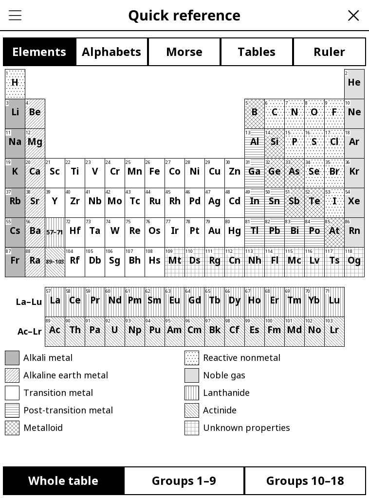

# reference.koplugin

A pocket reference for [KOReader](https://github.com/koreader/koreader):
periodic table, spelling and Greek alphabets, Morse code, number tables and
an on-screen ruler. French name: **Aide-mémoire**.

## Screenshot

## Sections

Pick a section with the tabs under the title bar (or the ☰ menu); a
horizontal swipe moves to the next or previous one. The last section used is
reopened next time (can be turned off in *Settings*).

- **Elements** — the periodic table of the 118 elements: atomic number,
  symbol and atomic mass in each cell, and each family (alkali metals,
  noble gases, lanthanides…) with its own grey pattern, explained in a
  legend. Tap an element for its name in French and English, atomic mass
  (most stable isotope in brackets), group, period, block and family.
  - *Landscape*: the whole table fits the screen, with the legend in the gap
    above the transition metals.
  - *Portrait*: the whole table in narrow cells, or **Groups 1–9** /
    **Groups 10–18** zoomed in with the element names (swipe to switch
    halves).
- **Alphabets** — the NATO/ICAO spelling alphabet (with the ICAO digits:
  Tree, Fower, Fife, Niner) and a **Spell a word…** button that spells any
  word or name; the Greek alphabet with upper case, lower case and name.
- **Morse** — the Morse table for letters and digits. Key in Morse with the
  dot and dash keys (**Letter** between letters, **Word** between words) and
  the text appears as you type; tap a letter of the table to add its code.
  **Text → Morse…** translates a typed text (accents are folded: é → E).
- **Tables** — multiplication tables 1 to 12 (tap a number for its table in
  large type, or see the full 12 × 12 grid), n², n³ and 2ⁿ up to 20, and the
  24 SI prefixes from quetta (10³⁰) to quecto (10⁻³⁰).
- **Ruler** — centimetres and inches drawn from the screen's DPI. Lay a real
  ruler on the 0 mark and adjust with **− 1 %**, **− 0.2 %**, **+ 0.2 %**,
  **+ 1 %** until the marks line up, or measure the 10 cm span and enter it
  with **Measure…**. The calibration is remembered; **Reset** goes back to
  the DPI alone.

## Where to find it

Tools → **Quick reference**.

## Why e-ink friendly?

Everything is drawn in black, white and two light greys: the element
families are told apart by patterns (dots, hatching, stripes), not by
colour. Buttons are large, the screen only redraws what a tap changed, and
the Morse keypad refreshes just its result box.

## License

GPL-3.0
